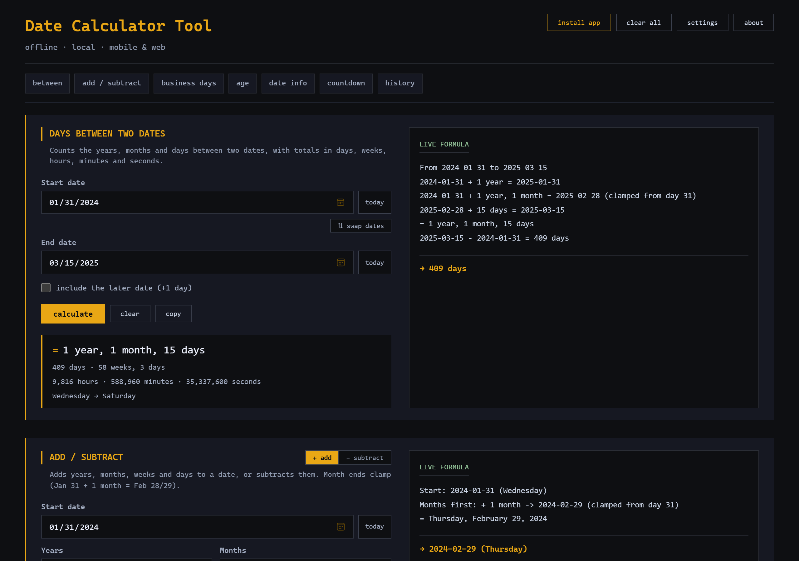
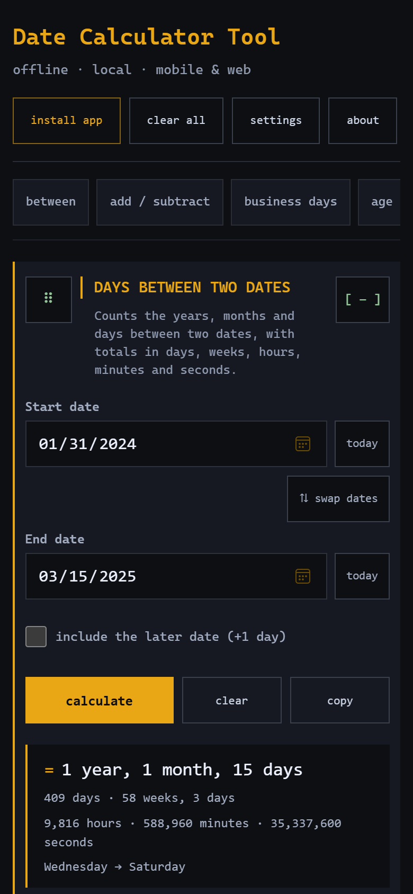

<p align="center">
  
</p>

<h1 align="center">Date Calculator Tool</h1>

<p align="center">
  <strong>Offline date calculator for Windows (Tauri v2 + Rust) and iPhone / Android PWA: days between dates, add or subtract time, business days with holidays, age, date info and countdowns</strong>
</p>

<p align="center">
  <a href="https://ciphervaults.github.io/Date-Calculator-Tool/"><strong>Mobile &amp; Web App</strong></a>
  &nbsp;·&nbsp;
  <a href="https://github.com/CipherVaults/Date-Calculator-Tool/releases/latest"><strong>Releases</strong></a>
  &nbsp;·&nbsp;
  <a href="#security--privacy"><strong>Security</strong></a>
  &nbsp;·&nbsp;
  <a href="Documentation/specs/0-%20FROZEN_DECISIONS.md"><strong>Design decisions</strong></a>
</p>

> **Status: v1.2.0 released on 2026-11-18** (collapsible and reorderable cards with a remembered layout). Earlier: v1.1.0 (clickable calendars, a countdown that survives restarts, safer history) and v1.0.0, both 2026-11-17/18.
>
> **What's new in v1.2.0:** collapse any card with [ − ]; reorder cards by dragging the ⠿ handle, with the arrow keys, or by tapping the handle for a Move up / Move down menu (works with VoiceOver and TalkBack); the layout is remembered, and Settings → Layout resets it. Full notes: [release-notes-v1.2.0.md](.github/release-notes-v1.2.0.md).
>
> **What's new in v1.1.0:** clickable mini calendars on Business Days, Date Info and Countdown (with keyboard support); the countdown is remembered across restarts and shows *restored*, *finished* or *finished while closed*; and an unreadable history file is never overwritten (history turns read-only, with Retry and a backed-up fresh start). The date engine is unchanged at 1.0.0. Full notes: [release-notes-v1.1.0.md](.github/release-notes-v1.1.0.md).
>
> The **Releases** link has the Windows installers, the portable `.exe`, the standalone mobile HTML and `SHA256SUMS.txt`. The **Mobile & Web App** link is live on GitHub Pages. Both are built by CI from `main`.
>
> **What comes next:** this app and [Percentage Calculator Tool](https://github.com/CipherVaults/Percentage-Calculator-Tool) are being merged into one app, **[Portable Calculator Tool](https://github.com/CipherVaults/Portable-Calculator-Tool)** (in development). It adds standard, scientific, programmer and graphing calculators, unit converters, a pop-up Mini Calculator, three themes and 12 languages. Date Calculator Tool keeps working in the meantime.

Date Calculator Tool is a sibling of [Percentage Calculator Tool](https://github.com/CipherVaults/Percentage-Calculator-Tool). It shares that project's architecture, security hardening and dark-terminal design, applied to date calculations. Its functional baseline is the familiar online date calculators, with more modes and real holiday rules.

---

## Previews

| Desktop & Wide Browser | iPhone & Android PWA |
| :---: | :---: |
|  |  |

---

## Credits

Made by **Mohamed Sayed · Ahmed Emara**, built with **Claude (Anthropic)**.

The repository is open about this AI collaboration, as its sibling project is.

---

## What This App Is

A fast, private date calculator that works entirely on your device:

- no login, accounts, telemetry, cookies or tracking
- no network calls during calculations; the PWA works fully offline once opened
- the only optional network use is a GitHub Releases update check, which can be turned off in Settings
- history (up to 500 entries), settings and the saved countdown stay local:
  - desktop: `%APPDATA%\com.datecalculator.tool\`
  - mobile and web: `localStorage`

---

## Features

Six calculator cards, available on both desktop and mobile:

- **Days Between Two Dates.** Years, months, weeks and days, plus totals in days, weeks, hours, minutes and seconds. Includes swap and "include the later date".
- **Add / Subtract from a Date.** ± years, months, weeks and days. An optional **business-day** mode moves years and months on the calendar, then counts weeks and days as working days.
- **Business Days.** Working days between two dates, skipping weekends and holidays, with the holidays it hit listed.
- **Age.** Exact age in years, months and days, totals, and the next birthday countdown. Feb 29 birthdays can count on Feb 28 or Mar 1.
- **Date Info.** Weekday, ISO week, day of year, quarter, leap year, and days left in the month and year.
- **Countdown.** A live countdown to a date and optional time, correct across daylight-saving changes. It is remembered on this device: reopen the app and it shows the exact time left, or that it finished (including "finished while the app was closed").

Calendar and holidays:

- **Weekends:** Sat/Sun, Fri/Sat, Fri only, or any custom set of days.
- **United States:** the 11 federal holidays, with weekend-observed days.
- **United Kingdom (England & Wales):** bank holidays, including Easter and substitute days.
- **Egypt:**
  - national days, Coptic Christmas, Coptic Easter and Sham el-Nessim;
  - Islamic holidays estimated from the tabular Hijri calendar and clearly marked "estimated", with a ±2-day adjustment and per-year overrides;
  - choosing Egypt switches the weekend to Fri/Sat.
- **Custom holidays:** one-off or yearly. Any preset holiday can be excluded.
- **Mini calendars** show weekends, holidays and ranges at a glance. On Business Days, Date Info and Countdown you can **click a day** to set the date (Business Days has a start/end switch), or use the keyboard.

Shared polish:

- live results while typing, with a "live formula" panel showing each step
- copy buttons and a history list with filter, restore and delete; an unreadable history file is never overwritten (history turns read-only, with Retry and a backed-up fresh start)
- quick-jump navigation, Enter-to-calculate, and dark Settings and About screens
- Windows NSIS and MSI installers, a portable `.exe`, and an installable offline PWA

---

## How Dates Are Calculated

- **Calendar:** proleptic Gregorian, years 0001–9999, using whole calendar days. Results never depend on your time zone, except the Countdown, which uses your local time.
- **Month ends clamp:**
  - Jan 31 + 1 month = Feb 28 (or Feb 29 in a leap year).
  - Jan 31 → Mar 1 reads as "1 month, 1 day".
  - Jan 31 + 1 month − 1 month = Jan 28.
- **Business days** count from the earlier date. The later date counts only when "include the later date" is on.
- **Holiday rules** cover 1900–2199. Outside that range, weekends still apply and the result carries a warning.

### Honest limitations

- **Islamic holidays are estimates.** Real dates follow moon sighting and official announcements, and can differ by 1–2 days. Use the offset or per-year overrides to match the official dates.
- **Egypt moves some holidays by decree** (for example to a Thursday). Those moves are not modelled; use exclusions and custom holidays.
- **UK one-off bank holidays** (royal events and similar) are included through 2027. Later ones need an app update.
- **Unsigned Windows binaries.** SmartScreen may warn on first run. Verify downloads against `SHA256SUMS.txt`.
- **GitHub Pages cannot send framing headers.** Always open or install the PWA from `https://ciphervaults.github.io/Date-Calculator-Tool/`.

---

## Security & Privacy

The same defence-in-depth approach as its sibling project:

- **Desktop:**
  - strict CSP with `connect-src 'none'`;
  - a Tauri capability with no permissions (`permissions: []`);
  - update checks run in Rust, not in the web view;
  - hardened JSON storage: size caps, symlink rejection, atomic writes and strict schemas.
- **Mobile:**
  - CSP pinned to SHA-256 hashes of the inline style and script;
  - a scoped service worker;
  - validated `localStorage`, with a one-time backup if data is ever corrupt.
- **Code:**
  - no `innerHTML`, `eval` or `new Function` anywhere;
  - the date engine is pure Rust (`#![forbid(unsafe_code)]`, no clock or time-zone access, no panics on any input).
- **CI:** GitHub Actions pinned to commit SHAs, `--locked` builds, and release checksums.

Controls and their verification status are tracked in [`Documentation/pbs/SECURITY_HARDENING_DOSSIER.md`](Documentation/pbs/SECURITY_HARDENING_DOSSIER.md).

---

## How It Works

```text
Desktop UI (ui/index.html, styles.css, main.js)
  -> Tauri invoke() commands (src-tauri/src/commands.rs)
  -> Pure Rust date engine (crates/date-core)
  -> Hardened local JSON history/settings, bounded clipboard IPC

Mobile & Web Edition (mobile/index.html + mobile/sw.js)
  -> Single-file HTML/CSS/JS with a JavaScript port of date-core
  -> Byte-for-byte parity with the Rust engine on every golden test case
  -> On-device localStorage history + offline service worker cache
```

There is no frontend framework and no bundler; the UI is plain HTML, CSS and JavaScript. All date and holiday logic lives in `date-core`. The mobile edition carries a line-by-line JavaScript copy of it, and CI proves both give identical output.

---

## Project Structure

```text
Cargo.toml              Rust workspace (date-core + src-tauri)
crates/date-core/       Pure Rust date engine, holiday rules, API, bridge, golden fixtures and tests
src-tauri/              Tauri v2 desktop shell, hardened commands, icons, capabilities
ui/                     Desktop frontend (HTML, CSS, JS)
mobile/                 Single-file PWA, service worker, manifest and icons
scripts/                Mobile parity gate, safety evaluation, local PWA server, icon generator
assets/                 Source icons and README previews
Documentation/          Context, architecture, roadmap, session summary, specs and PBS records
.github/                Release notes; workflows/ for CI (tests, smoke test, Windows bundles, checksums, Pages)
```

---

## Prerequisites (building from source)

- [Rust](https://rustup.rs/) stable (MSVC toolchain on Windows)
- Tauri CLI v2:
  ```powershell
  cargo install tauri-cli --version "=2.12.4" --locked
  ```
- Node.js 20 or newer, only for the checks and tools in `scripts/` (no npm packages)
- On Windows, run Cargo from **PowerShell**, not Git Bash. Git Bash's `link` shadows the MSVC linker.

---

## Run Locally

```powershell
cargo tauri dev
```

The Mobile & Web PWA can be tried locally, at the same path GitHub Pages uses:

```powershell
node scripts/serve-mobile.mjs
# then open http://127.0.0.1:8787/Date-Calculator-Tool/
```

---

## Test

```powershell
cargo fmt --all -- --check
cargo clippy --workspace --all-targets --locked -- -D warnings
cargo test --workspace --locked
cargo run -p date-core --example gen_golden --locked -- --check
```

The 134 Rust tests (104 engine, 30 desktop backend) check:
- every day from 0001-01-01 to 9999-12-31 (3,652,059 days) against the `chrono` library;
- 195 hand-verified vectors;
- published US/UK/Egypt holiday tables;
- business-day properties against a day-by-day loop;
- that every result's copy text fits the 1024-byte history limit;
- a 13,965-case golden fixture shared with the mobile engine;
- adversarial and fuzz safety cases;
- the desktop's history, settings and countdown storage (including read-only history on read errors and backups before any reset), validation and update-check parsing.

Mobile parity gate. It checks CSP hashes, line endings, banned DOM sinks and that the version matches everywhere, then replays all golden cases through the mobile engine under three time zones:

```powershell
node scripts/check-mobile.mjs
```

Cross-surface safety evaluation (87 criteria, including 29 planted bugs it must catch). It compares the Rust engine, the mobile engine and an independent oracle, drives both UIs in a simulated DOM, and writes a System Card:

```powershell
node scripts/safety-eval.mjs --json target/safety-eval-system-card.json
```

Desktop smoke test. It launches the real app hidden, keeps history, settings and the countdown in memory only, round-trips a countdown save, and writes a test string to the clipboard:

```powershell
cargo run -p date-calculator-tool --locked -- --smoke-test
```

---

## Build for Windows

```powershell
cargo tauri build -- --locked
```

Each release attaches:
- the NSIS installer;
- the MSI installer;
- a portable `.exe`;
- the standalone mobile HTML;
- `SHA256SUMS.txt`.

Verify a download before opening it:

```powershell
Get-FileHash .\<downloaded-file> -Algorithm SHA256
# Compare with the matching line in SHA256SUMS.txt
```

On Linux or macOS, with the downloaded files and `SHA256SUMS.txt` in one folder:

```bash
sha256sum -c --ignore-missing SHA256SUMS.txt
# macOS without sha256sum: shasum -a 256 -c --ignore-missing SHA256SUMS.txt
```

---

## Documentation

- [`AGENTS.md`](AGENTS.md): contributor and AI-agent conventions, including Git rules
- [`HANDOFF.md`](HANDOFF.md): how to build, test, change and release the project
- [`Documentation/1- PROJECT_CONTEXT.md`](Documentation/1-%20PROJECT_CONTEXT.md): purpose and scope
- [`Documentation/2- ARCHITECTURE.md`](Documentation/2-%20ARCHITECTURE.md): engine, desktop shell, PWA, parity gates and CI
- [`Documentation/specs/`](Documentation/specs/): frozen decisions, date math spec, holiday rules spec, build plan and design critique
- [`Documentation/3- ROADMAP.md`](Documentation/3-%20ROADMAP.md): milestones and status
- [`Documentation/4- SESSION_SUMMARY.md`](Documentation/4-%20SESSION_SUMMARY.md): what was built in each session
- [`Documentation/pbs/`](Documentation/pbs/): current state, continuation, execution ledger, security dossier and source map

---

## License

All rights reserved (UNLICENSED). The source is public for transparency and review; no open-source license is granted.

---

## Design Philosophy

- simplicity over feature bloat
- offline use over cloud dependency
- one engine, proven identical on every platform
- honest limits over silent guesses
- defence-in-depth defaults over implicit trust
- visible automated tests over manual-only confidence
